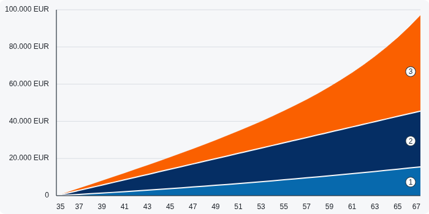

# Angular SVG stacked area chart

A standalone presentational component based on the supplied reference image. Three financial series, native SVG, smooth shared boundaries, EUR axes, and numbered badges. Chart geometry has no runtime dependencies.



## Run in Docker

```sh
export LOCAL_UID="$(id -u)" LOCAL_GID="$(id -g)"
docker compose run --rm tooling npm ci --ignore-scripts
docker compose up -d dev preview
```

Open [localhost:4200](http://localhost:4200). The demo has smooth/straight modes, a container-width slider, and reference, sparse, zero, single-point, and empty datasets.

```sh
docker compose run --rm check npm test -- --watch=false
docker compose run --rm check npm run build
docker compose run --rm check npm run format:check
docker compose down
```

Production output is in `dist/stacked-area-chart-svg-angular/browser`. The UID/GID variables keep generated project files under your ownership. Docker is the only required host tool.

Optional Make shortcuts are `make install`, `make dev`, `make check`, and `make stop`. `make check` runs all three checks. On a Nix machine, `nix-shell -p gnumake` provides Make temporarily.

The Node image is pinned by digest. Containers run as an unprivileged user with a read-only root, dropped capabilities, resource limits, and a project-only mount. Dependency lifecycle scripts are disabled. Builds and tests run without networking. The Angular server uses an internal network; a small Node-built-in-only proxy exposes `127.0.0.1:4200` and mounts only its own source file read-only.

## Use the component

### Minimal proof of concept

The second chart in the demo uses `src/app/minimal-stacked-area-chart/`. Copy that
directory and `THIRD_PARTY_NOTICES.md` into an Angular 20+ project. The four source
files contain the component, template, styles, and smooth-path calculations;
their only package dependency is `@angular/core`.

Import the component into your parent's `imports` array:

```ts
import { Component } from '@angular/core';
import { MinimalStackedAreaChart } from './minimal-stacked-area-chart/minimal-stacked-area-chart';
import type { StackedAreaChartPoint } from './minimal-stacked-area-chart/geometry';

@Component({
  selector: 'app-example',
  standalone: true,
  imports: [MinimalStackedAreaChart],
  template: '<app-minimal-stacked-area-chart [data]="projection" />',
})
export class Example {
  readonly projection: readonly StackedAreaChartPoint[] = [
    { age: 35, contributions: 0, governmentSupport: 0, investmentGrowth: 0 },
    { age: 51, contributions: 6510, governmentSupport: 16240, investmentGrowth: 12000 },
    { age: 67, contributions: 15500, governmentSupport: 30000, investmentGrowth: 51500 },
  ];
}
```

The example has one input and always draws smooth curves. Supply at least two
distinct ages with finite, nonnegative amounts. It follows the container width
between 290px and 700px, with a maximum height of 350px.

### Full component

Import `StackedAreaChart` into the parent component's `imports` array:

```ts
import { StackedAreaChart, type StackedAreaChartPoint } from './stacked-area-chart';

const projection: readonly StackedAreaChartPoint[] = [
  { age: 35, contributions: 0, governmentSupport: 0, investmentGrowth: 0 },
  { age: 51, contributions: 6510, governmentSupport: 16240, investmentGrowth: 12000 },
  { age: 67, contributions: 15500, governmentSupport: 30000, investmentGrowth: 51500 },
];
```

```html
<app-stacked-area-chart
  [data]="projection"
  interpolation="monotone"
  title="Kapitalentwicklung nach Alter"
/>
```

| Input           | Type                               | Default                         |
| --------------- | ---------------------------------- | ------------------------------- |
| `data`          | `readonly StackedAreaChartPoint[]` | Required                        |
| `interpolation` | `'monotone' \| 'linear'`           | `'monotone'`                    |
| `title`         | `string`                           | `Kapitalentwicklung nach Alter` |

Each amount supplies one band's value at that age. The upper boundary is the sum of all three amounts. Band order is contributions (blue), government support (navy), then investment growth (orange). Supply a new array when updating data.

The component follows its container between **290px and 700px**. Height is `clamp(260px, width / 2, 350px)`. Labels keep a readable font size, age ticks become less dense on small screens, and narrow currency ticks use explicit thousands/millions units. Containers below 290px can wrap the component in `overflow-x: auto`.

## Data behavior

- Ages are finite numbers and must be unique. A sorted copy is used; input records are untouched.
- Amounts must be finite and nonnegative. Invalid or numerically unrepresentable data shows an invalid-data state.
- Empty input shows an empty state. All-zero input keeps the zero baseline without positive monetary ticks.
- One age shows a narrow stacked marker. Two ages use straight boundaries.
- Badges appear only when their entire circle fits inside the band.
- The SVG's title and description identify the age range, series, and final amounts. Each instance has its own accessibility and clipping IDs.

## Implementation

- `src/app/stacked-area-chart/stacked-area-chart.ts`, `.html`, `.scss`: signal inputs, resize observation, labels, badges, and SVG rendering.
- `src/app/stacked-area-chart/chart-geometry.ts`: cumulative stacks, nice y ticks, shared Bézier boundaries, and closed area paths.
- `src/app/demo-data.ts`: example data owned by the demo parent.

The tangent calculation and Hermite-to-Bézier conversion are adapted from **d3-shape's `src/curve/monotone.js`**. Stack accumulation and upper-forward/lower-reverse area traversal follow its `stack.js`, `offset/none.js`, and `area.js`. Shared per-knot tangent damping keeps all band controls ordered while retaining continuous slopes and bounded totals. Adjacent fills and white separators reuse identical geometry.

See [THIRD_PARTY_NOTICES.md](THIRD_PARTY_NOTICES.md) for the retained ISC license. The notice is included in production assets.
